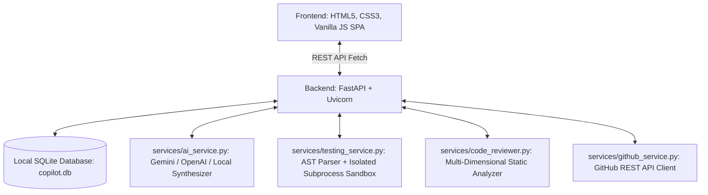

# AI Software Engineering Copilot ✦

> A full-stack, local-first developer assistant web application built with **FastAPI**, **SQLite**, semantic **HTML5**, **Vanilla CSS**, and **Vanilla JavaScript**. Designed for local computer execution without requiring paid subscriptions or cloud dependencies.

---

## 📌 Project Overview

**AI Software Engineering Copilot** is a developer productivity platform designed as a complete software engineering project. It provides:
1. **Developer Dashboard**: Live system telemetry, real SQLite activity metrics, and quick-action navigation.
2. **AI Code Generator**: High-fidelity code synthesis for Python, JavaScript, C++, and Java with an offline heuristic engine (Demo Mode) and optional Google Gemini / OpenAI integration.
3. **Automated Testing**: AST-driven Python unit test generation (`unittest.TestCase`) and safe isolated subprocess execution with timeout and security guardrails.
4. **AI Code Reviewer**: Multi-dimensional static analysis detecting hardcoded secrets, SQL injection, dynamic evaluation, exception handling flaws, readability bottlenecks, and cyclomatic complexity.
5. **GitHub Assistant**: Public repository inspector using the GitHub REST API to browse root files, inspect READMEs, view recent commits, and generate read-only Pull Request review checklists.
6. **Task History**: Persistent SQLite task storage with search, filtering, JSON inspection, deletion, and one-click task restoration.

---

## 🛠️ Architecture & Tech Stack



- **Backend**: Python 3.10+, FastAPI, Pydantic v2, SQLite3 (WAL mode), Uvicorn.
- **Frontend**: Semantic HTML, Custom Responsive CSS (Clean Light Theme, soft blue/purple accents), Vanilla JavaScript (`fetch()` API).
- **Security & Sandboxing**: AST-based code screening, isolated child subprocess runner with strict 3.5s timeout, zero browser secret exposure.
- **Testing**: Automated test suite with `pytest` and `fastapi.testclient.TestClient`.

---

## 📂 Project Structure

```text
├── main.py                     # FastAPI application entrypoint & API routes
├── pytest.ini                  # Pytest configuration
├── requirements.txt            # Python dependencies
├── .env.example                # Configuration template with optional API keys
├── .gitignore                  # Git ignore rules for virtualenvs, caches & SQLite
├── README.md                   # Complete documentation & viva reference
├── database/
│   ├── db.py                   # SQLite connection manager, WAL mode & schemas
│   └── models.py               # Data models and CRUD query functions
├── services/
│   ├── ai_service.py           # Code generator with Gemini/OpenAI & local fallback
│   ├── testing_service.py      # AST test generation & isolated subprocess sandbox
│   ├── code_reviewer.py        # Static analysis engine (security, bugs, readability)
│   └── github_service.py       # GitHub REST API client & read-only PR reviewer
├── static/
│   ├── css/
│   │   └── styles.css          # Modern light-theme design system & responsive layout
│   └── js/
│       └── app.js              # Client-side router, API fetcher & DOM controllers
├── templates/
│   └── index.html              # Single-page dashboard semantic HTML
└── tests/
    ├── __init__.py
    └── test_copilot_api.py     # Automated API endpoint test suite
```

---

## 🚀 Quickstart & Installation

### 1. Prerequisites
- Python 3.10, 3.11, 3.12, 3.13, or 3.14 installed.
- Git (optional).

### 2. Run on Windows (PowerShell)

```powershell
# 1. Create a virtual environment
python -m venv .venv

# 2. Activate the virtual environment
.venv\Scripts\Activate.ps1
# Note: If PowerShell displays an execution policy error, run:
# Set-ExecutionPolicy -ExecutionPolicy RemoteSigned -Scope Process

# 3. Install dependencies
pip install -r requirements.txt

# 4. Create your local .env file
Copy-Item .env.example .env

# 5. Start the FastAPI development server
uvicorn main:app --reload --host 127.0.0.1 --port 8000
```

### 3. Run on Linux / macOS (Bash / Zsh)

```bash
# 1. Create a virtual environment
python3 -m venv .venv

# 2. Activate the virtual environment
source .venv/bin/activate

# 3. Install dependencies
pip install -r requirements.txt

# 4. Create your local .env file
cp .env.example .env

# 5. Start the FastAPI development server
uvicorn main:app --reload --host 127.0.0.1 --port 8000
```

Open your web browser and navigate to:
👉 **`http://127.0.0.1:8000`**

Interactive OpenAPI Documentation is available at:
👉 **`http://127.0.0.1:8000/docs`**

---

## 🧪 Running Automated Tests

Run the included pytest suite to verify all API endpoints, AST generators, database operations, and security guardrails:

```bash
python -m pytest -v
```

All 9 test suites execute against an isolated temporary test database:
- `test_health_check`: Verifies system diagnostics, provider flags, and sandbox availability.
- `test_dashboard_metrics`: Verifies real aggregate counts from SQLite.
- `test_code_generation_and_history`: Verifies deterministic code synthesis and task persistence.
- `test_generate_input_validation`: Verifies Pydantic schema validation.
- `test_automated_test_generation_and_run`: Verifies AST test synthesis and safe isolated subprocess execution.
- `test_security_guardrail_blocks_dangerous_code`: Verifies interception of malicious system commands.
- `test_code_reviewer`: Verifies detection of hardcoded secrets, mutable defaults, and bare excepts.
- `test_github_url_validation`: Verifies URL validation and format handling.
- `test_history_crud`: Verifies task listing, filtering, and deletion.

---

## 🧭 Core Modules Walkthrough

### 1. Developer Dashboard
- Shows real-time counts for **Total Saved Tasks**, **Code Generations**, **Tests Executed**, and **Code Reviews**.
- Displays recent workspace activity with status badges and module timestamps.
- Status indicators show whether the system is running in **Demo Mode** or with a configured **Live AI**.

### 2. AI Code Generator
- Generates idiomatic code in **Python**, **JavaScript**, **C++**, or **Java**.
- Select architecture styles: *Standard Idiomatic*, *Object-Oriented Class*, or *Production-Ready*.
- Includes preset chips for common algorithms (LRU Cache, Binary Search, Factorial, REST API, Singleton).
- Features one-click **Copy Code** and **Download File** (`.py`, `.js`, `.cpp`, `.java`).
- Operates in offline **Demo Mode** by default. Supports optional **Google Gemini** or **OpenAI** via `.env`.

### 3. Automated Testing & Sandboxing
- **AST Test Synthesis**: Automatically inspects Python function signatures and generates a complete `unittest.TestCase` suite with assertions for typical cases, zero cases, and boundary cases.
- **Subprocess Isolation**: Untrusted code is executed inside a temporary child process using `subprocess.run` with a strict 3.5-second timeout.
- **AST Security Guardrail**: Prior to execution, code is statically scanned. Disallows imports of `os`, `sys`, `subprocess`, `socket`, `shutil`, `ctypes`, and calls to `eval`, `exec`, or `open`.
- If unsafe code is detected, execution is intercepted with an educational security alert.

### 4. AI Code Reviewer
- Multi-language static code analysis (Python, JS, C++, Java).
- Evaluates four key dimensions:
  - **Security**: Hardcoded API keys, JWTs, SQL injection concatenation, dynamic execution `eval()`, prototype pollution, buffer overflows.
  - **Bugs & Exceptions**: Bare `except:`, mutable default arguments, divide-by-zero, loose equality `==`, missing `delete` in C++.
  - **Readability**: PEP8 naming conventions, missing docstrings, long lines (>120 chars), deep nesting (>4 levels).
  - **Maintainability**: File length, cyclomatic complexity estimation, modularity.
- Generates an overall **Code Health Score (0-100)**, **Letter Grade (A+ to F)**, and concrete **Suggested Fix** snippets.

### 5. GitHub Assistant
- Enter any public repository URL (e.g., `https://github.com/tiangolo/fastapi`).
- Inspects repository telemetry: Stars, Forks, Open Issues, License, Primary Language, and Default Branch.
- **File Explorer**: Browse root directory files and click any source file to inspect its contents in the code viewer.
- **README Viewer**: View the repository's README rendered in markdown.
- **Recent Commits**: List latest commits with authors and commit SHAs.
- **Pull Request Reviewer**: Inspects open Pull Requests and performs automated read-only checklist reviews. Never pushes or merges commits.

### 6. Task History
- Persistent local SQLite table storing all generated artifacts, test runs, code reviews, and repository queries.
- Instant module filtering (`All`, `Code Generator`, `Automated Testing`, `Code Review`, `GitHub`).
- Real-time text search.
- **Reopen Action**: Restores saved inputs and outputs directly into the respective tool view so you can continue editing.
- **Inspect JSON**: Detailed modal view for reviewing raw database payloads.
- **Delete / Clear**: Delete individual records or reset history.

---

## 🔒 Security & Sandboxing Principles (College Viva Reference)

When presenting this project in a viva or interview, emphasize these core software engineering principles:

1. **Why Arbitrary Code Must Never Run in the Main Web Server Process**:
   - If user code executes directly in the FastAPI process, an infinite loop (`while True: pass`) will freeze the server for all requests.
   - Malicious commands (`os.system("rm -rf /")` or `shutil.rmtree`) could wipe the host machine or steal server credentials.
   - Memory leaks in submitted code would exhaust the host memory (OOM crash).

2. **Defense-in-Depth Implementation in this Project**:
   - **Layer 1: AST Pre-Execution Scanning**: Uses Python's built-in `ast` module to traverse the Abstract Syntax Tree. Any node importing dangerous modules or calling dynamic execution functions is rejected before a process is even spawned.
   - **Layer 2: Dedicated Child Subprocess**: The permitted code runs in a distinct OS process spawned via `subprocess.run([sys.executable, ...])` inside an isolated temporary folder.
   - **Layer 3: Execution Time Limits**: A timeout of 3.5 seconds is enforced; if the process does not terminate, `subprocess.TimeoutExpired` kills the child process.
   - **Production Recommendations**: For multi-tenant cloud systems, explain that production environments augment this with Linux kernel isolation (namespaces, `cgroups`, `seccomp-bpf`, or microVMs like Firecracker and gVisor).

3. **API Key & Secret Safety**:
   - External API keys (e.g., `GEMINI_API_KEY`, `GITHUB_TOKEN`) are configured server-side via `.env`.
   - Keys are NEVER passed to client-side HTML, CSS, or JavaScript.
   - Diagnostics endpoints only reveal whether a key is configured (`true`/`false`) and the provider name, never the secret string.

---

## 📡 API Reference Summary

| Method | Endpoint | Description |
|---|---|---|
| `GET` | `/` | Serves Developer Dashboard SPA |
| `GET` | `/api/health` | System diagnostics & engine configuration status |
| `GET` | `/api/dashboard` | Workspace telemetry & recent activities |
| `POST` | `/api/generate` | Synthesize source code from requirement prompt |
| `POST` | `/api/test/generate-tests` | Synthesize `unittest.TestCase` suite via AST |
| `POST` | `/api/test/run` | Execute unit tests in isolated subprocess sandbox |
| `POST` | `/api/review` | Run multi-dimensional static code audit |
| `POST` | `/api/github/inspect` | Fetch public repository telemetry & root files |
| `POST` | `/api/github/file` | Retrieve specific source file content from repo |
| `POST` | `/api/github/readme` | Retrieve repository README |
| `POST` | `/api/github/pulls` | Fetch open PRs and perform automated review |
| `GET` | `/api/history` | List task history with module & keyword filters |
| `GET` | `/api/history/{id}` | Retrieve individual task details |
| `DELETE` | `/api/history/{id}` | Delete task record |
| `DELETE` | `/api/history` | Clear entire task history |

---

## 📄 License

MIT License. Free and open-source for educational and commercial use.
