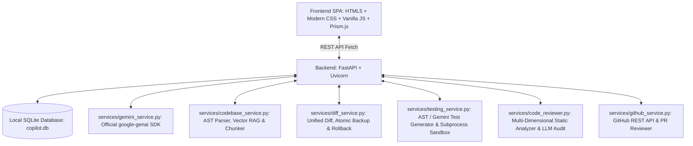

# AI Software Engineering Copilot — Gemini Edition ✦

> A modular, local-first developer productivity dashboard and AI engineering platform built with **Python 3.11**, **FastAPI**, **SQLite**, and **Google Gemini** (via the official `google-genai` SDK). Engineered for local execution on Windows with VS Code.

---

## 📌 Project Overview

**AI Software Engineering Copilot — Gemini Edition** is an end-to-end software engineering assistant designed for real-world developer workflows. It runs 100% locally on your computer with a local SQLite database, clean modular services, and secure Google Gemini cloud intelligence:

1. **User-Selectable Gemini Models**: Choose among `gemini-2.5-flash` (default), `gemini-2.5-pro`, `gemini-2.0-flash`, `gemini-1.5-flash`, and `gemini-1.5-pro` with live backend validation and session persistence.
2. **Codebase Intelligence (RAG & Code Understanding)**:
   - Point to any local workspace folder.
   - Extracts complete project structure, AST symbols (classes, functions, methods, imports), and file relationships.
   - Automatically excludes sensitive/build folders (`.venv`, `.git`, `.env`, `node_modules`, `__pycache__`, build artifacts).
   - Indexes code into searchable semantic chunks using Gemini embeddings (with pure-Python token cosine similarity fallback when offline).
   - Answers natural language questions grounded directly in actual source code with cited file paths, line numbers, and snippet previews.
   - Traces architectural topology, entry points (`main.py`, `app.py`), and module symbol density.
3. **Safe AI Code Modification & Unified Diffs**:
   - Propose refactoring or code additions on any workspace file.
   - Inspect visual unified diffs (color-coded additions in green, deletions in red, and hunk headers).
   - Requires **explicit user approval** before any disk write.
   - Creates timestamped atomic `.backup` copies (`file.py.YYYYMMDD_HHMMSS.backup`).
   - Automatically runs syntax verification and test suites on modified files.
   - Provides a one-click **Rollback** mechanism to restore the original file at any time.
   - Maintains a complete SQLite audit trail in `pending_changes`.
4. **AI Code Generator**: High-fidelity code synthesis for Python, JavaScript, C++, and Java with an offline heuristic fallback (Demo Mode) and dynamic Gemini synthesis when configured.
5. **Automated Testing & Subprocess Isolation**: AST-driven unit test generation (`unittest.TestCase`), Gemini-powered edge-case test generation, and isolated child process execution with timeouts (5.0s) and static AST security audits.
6. **AI Code Reviewer**: Hybrid static analysis combining rule-based AST security checks (detecting hardcoded secrets, SQL injection, eval, bare except, mutable defaults) with deep Gemini semantic code reviews.
7. **GitHub Assistant**: Public repository inspector using the GitHub REST API to browse root files, inspect READMEs, view recent commits, and generate automated PR review checklists.
8. **Task History**: Persistent SQLite task storage with search, filtering, JSON inspection, and deletion.

---

## 🛠️ Architecture & Tech Stack



- **Backend**: Python 3.11, FastAPI, Pydantic v2, SQLite3 (WAL mode), Uvicorn.
- **AI SDK**: Official `google-genai` Python SDK (`from google import genai`).
- **Frontend**: Semantic HTML5, CSS3 Custom Theme (Responsive Light Theme), Vanilla JavaScript, and Prism.js for syntax highlighting.
- **Security & Sandboxing**: AST-based code screening, child subprocess runner with timeout guardrails, zero browser secret exposure.
- **Testing**: 34 automated unit and integration tests with `pytest` and `fastapi.testclient.TestClient`.

---

## 📂 Project Structure

```text
├── main.py                     # FastAPI application entrypoint, CORS & API routes
├── pytest.ini                  # Pytest configuration
├── requirements.txt            # Python dependencies (includes google-genai)
├── .env.example                # Configuration template (GEMINI_API_KEY, DEFAULT_GEMINI_MODEL)
├── .gitignore                  # Git ignore rules for .env, .venv, *.backup, caches & SQLite
├── README.md                   # Complete documentation & viva reference
├── database/
│   ├── db.py                   # SQLite connection manager, WAL mode & schemas
│   └── models.py               # Data models and CRUD query functions (tasks, codebase, diffs)
├── services/
│   ├── gemini_service.py       # Centralized official google-genai SDK integration & model manager
│   ├── codebase_service.py     # Codebase Intelligence: AST parser, chunking, vector embeddings, RAG
│   ├── diff_service.py         # Safe AI Code Modification: unified diffs, approval, backups, rollback
│   ├── ai_service.py           # Code generator, explanation, and improvement service
│   ├── testing_service.py      # AST/AI test generator & isolated subprocess sandbox
│   ├── code_reviewer.py        # Static analysis engine & Gemini semantic code reviewer
│   └── github_service.py       # GitHub REST API client & read-only PR reviewer
├── static/
│   ├── css/
│   │   └── styles.css          # Modern light-theme design system & responsive layout
│   └── js/
│       └── app.js              # Client-side router, model selector, RAG & diff controllers
├── templates/
│   └── index.html              # Single-page developer dashboard
└── tests/
    ├── __init__.py
    ├── test_copilot_api.py     # 18 baseline API endpoint tests
    └── test_gemini_edition.py  # 16 comprehensive Gemini Edition tests
```

---

## 🚀 Quickstart & Setup on Windows (VS Code)

### 1. Prerequisites
- **Python**: 3.11.9 (or 3.10+) installed.
- **Virtual Environment**: `.venv` in the project root.
- **VS Code**: Visual Studio Code editor.

### 2. Run in VS Code PowerShell Terminal

```powershell
# 1. Activate the existing virtual environment (.venv)
.\.venv\Scripts\Activate.ps1
# If PowerShell displays an execution policy error, enable local script execution:
# Set-ExecutionPolicy -ExecutionPolicy RemoteSigned -Scope Process

# 2. Verify / install dependencies
python -m pip install -r requirements.txt

# 3. Create your local .env configuration (optional)
Copy-Item .env.example .env

# 4. Run all 34 automated tests to verify the installation
python -m pytest -v

# 5. Start the development server
python -m uvicorn main:app --reload --host 127.0.0.1 --port 8000
```

### 3. Adding Your Google Gemini API Key

You can use the application immediately in **Demo Mode (Offline)** without any API key. When you are ready to enable live Gemini AI:

1. Obtain a free API key from [Google AI Studio](https://aistudio.google.com/).
2. Open `.env` in your project root.
3. Add your key:
   ```env
   GEMINI_API_KEY=your_actual_gemini_api_key_here
   DEFAULT_GEMINI_MODEL=gemini-2.5-flash
   ```
4. Restart the server. The dashboard will automatically detect your key and switch to **Live Gemini AI Active**.

---

## 🧪 Automated Testing & Verification

Run the complete 34-test automated test suite:

```bash
python -m pytest -v
```

All 34 tests execute cleanly without network dependencies:
- **18 Baseline Tests (`tests/test_copilot_api.py`)**: Covers dashboard telemetry, code generation, AST test generation, isolated subprocess sandbox execution, security guardrail interception, multi-language code review, GitHub inspection, and history CRUD.
- **16 Gemini Edition Tests (`tests/test_gemini_edition.py`)**: Covers missing API key graceful handling, model selection & validation (`gemini-2.5-flash`, `gemini-2.5-pro`), mocked Gemini generation, rate limit & error handling, codebase directory scanner exclusions (`.venv`, `.git`, `.env`), AST symbol extraction, codebase RAG Q&A (offline vs live), safe code modification lifecycle (propose -> diff -> approve -> backup -> test -> rollback), sensitive file protection, and sandbox disclaimer verification.

---

## 🧭 Gemini Edition Features Walkthrough

### 1. User-Selectable Gemini Models
- Dropdown selector in the top navigation bar and in the Gemini Settings view.
- Supports `gemini-2.5-flash` (recommended default), `gemini-2.5-pro`, `gemini-2.0-flash`, `gemini-1.5-flash`, and `gemini-1.5-pro`.
- Active model selection is maintained on the backend and used across all AI operations.

### 2. Codebase Intelligence (RAG & Code Understanding)
- Navigate to the **Codebase Intelligence** tab.
- Enter any local folder path (defaults to current project `.`).
- Click **Scan & Index Codebase**:
  - Automatically walks the directory while ignoring `.venv`, `.git`, `.env`, `node_modules`, and build folders.
  - Parses classes, functions, docstrings, and imports via Python `ast`.
  - Generates searchable chunks and persistent embeddings stored in SQLite (`copilot.db`).
- Click **Trace Architecture**: Displays entry points (`main.py`, `app.py`) and top modules by symbol density.
- **Ask Your Codebase**: Type natural-language questions (e.g. *"Where is database initialization implemented?"*). The system retrieves the top relevant chunks using hybrid vector + keyword matching, cites exact file paths and line ranges, and synthesizes grounded answers using Gemini.

### 3. Safe AI Code Modification & Unified Diffs
- Navigate to the **Safe Refactor / Diffs** tab.
- Enter the target workspace file and your refactoring instruction.
- Click **Propose Modification**: Gemini analyzes the code and generates a proposal **without touching the file on disk**.
- Inspect the visual unified diff:
  - Additions highlighted in green (`+`)
  - Deletions highlighted in red (`-`)
  - Hunk headers highlighted in purple (`@@`)
- Click **Approve & Apply Changes**:
  - Automatically creates a timestamped `.backup` copy (`file.py.20261113_200500.backup`).
  - Writes proposed code cleanly to the target file.
  - Automatically runs syntax verification and automated tests.
- Click **Rollback Changes to Backup**: Instantly restores the original file from the backup copy if needed.

### 4. AI Code Generator & Explainer
- Synthesize idiomatic code in Python, JavaScript, C++, or Java.
- Click **Explain Code** (`POST /api/explain`) to get algorithmic complexity and design insights.
- Click **Improve Code** (`POST /api/improve`) to receive actionable refactoring recommendations.

### 5. Automated Testing & Subprocess Sandbox
- Synthesizes `unittest.TestCase` suites via AST analysis or Gemini.
- Runs tests in an isolated child process with a 5.0-second timeout.
- Prior to execution, code is statically audited via AST to prevent disallowed system imports (`os`, `sys`, `subprocess`, `socket`, `shutil`).

---

## 🔒 Security & Sandboxing Principles (College Viva Reference)

When presenting this project in a viva, interview, or defense, highlight these engineering principles:

1. **Why Arbitrary Code Must Never Run in the Main Web Server Process**:
   - If user code executes directly inside FastAPI, an infinite loop (`while True: pass`) will freeze the entire event loop for all requests.
   - Malicious commands (`shutil.rmtree` or `os.system`) could delete project files or compromise host credentials.
   - Memory leaks in submitted code would exhaust system RAM (OOM crash).

2. **Defense-in-Depth Implementation in this Project**:
   - **Layer 1: AST Pre-Execution Scanning**: Uses Python's `ast` module to reject dangerous imports and function calls before any process is spawned.
   - **Layer 2: Dedicated Child Subprocess**: The permitted code runs in a distinct OS process spawned via `subprocess.run([sys.executable, ...])` inside an isolated temporary directory.
   - **Layer 3: Execution Time Limits**: A strict 5.0-second timeout ensures infinite loops are killed automatically.
   - **Disclosure**: Clarifies in UI and documentation that this is educational process isolation, not a full hypervisor virtual machine.

3. **API Key Safety**:
   - `GEMINI_API_KEY` is loaded strictly server-side from `.env`.
   - Never exposed to browser JavaScript or HTML templates.
   - `.env` is strictly excluded from version control via `.gitignore`.

---

## 📡 Complete API Reference

| Method | Endpoint | Description |
|---|---|---|
| `GET` | `/` | Serves Developer Dashboard SPA |
| `GET` | `/api/health` | System diagnostics, engine status, and sandbox notice |
| `GET` | `/api/models` | List supported Gemini models and active selection |
| `POST` | `/api/models/select` | Select active Gemini model for the session |
| `GET` | `/api/dashboard` | Workspace telemetry & recent activities |
| `POST` | `/api/generate` | Synthesize source code from prompt |
| `POST` | `/api/explain` | Explain logic and complexity of a code snippet |
| `POST` | `/api/improve` | Suggest performance and architecture improvements |
| `POST` | `/api/test/generate-tests` | Synthesize unit test suite via AST or Gemini |
| `POST` | `/api/test/run` | Execute tests in isolated subprocess sandbox |
| `POST` | `/api/review` | Run multi-dimensional static and semantic code audit |
| `POST` | `/api/codebase/scan` | Scan local repository and index vector chunks |
| `POST` | `/api/codebase/query` | Grounded RAG Q&A against indexed codebase |
| `GET` | `/api/codebase/status` | Check if a local directory is indexed |
| `POST` | `/api/codebase/architecture`| Trace architectural entry points and module hierarchy |
| `POST` | `/api/diff/propose` | Propose refactoring with visual unified diff (no disk write) |
| `POST` | `/api/diff/apply` | Apply approved diff, create `.backup`, and run tests |
| `POST` | `/api/diff/reject` | Reject diff proposal without modifying disk |
| `POST` | `/api/diff/rollback` | Restore original file from `.backup` copy |
| `GET` | `/api/diff/history` | List code modification proposals and their status |
| `POST` | `/api/github/inspect` | Fetch public repository telemetry & root files |
| `POST` | `/api/github/file` | Retrieve specific source file content from repo |
| `POST` | `/api/github/readme` | Retrieve repository README |
| `POST` | `/api/github/pulls` | Fetch open PRs and perform automated review |
| `GET` | `/api/history` | List task history with module & keyword filters |
| `GET` | `/api/history/{id}` | Retrieve individual task details |
| `DELETE` | `/api/history/{id}` | Delete task record |
| `DELETE` | `/api/history` | Clear entire task history |

---

## 📄 License

MIT License. Free and open-source for educational and commercial use.
